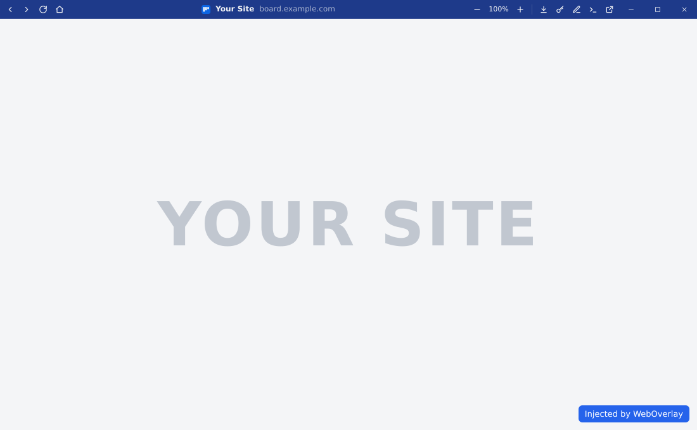
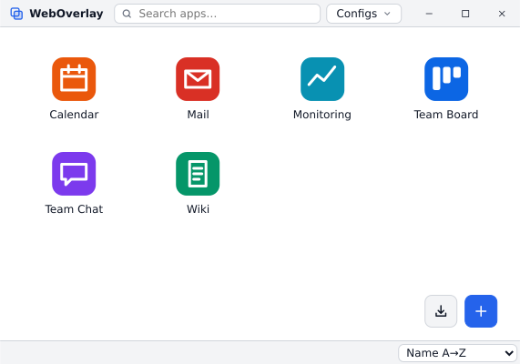

# WebOverlay

<p align="center"></p>

Open any website as a standalone desktop webapp (Tauri 2) and inject your own JavaScript and CSS into it.
Linux and Windows.

<p align="center"><picture><source media="(prefers-color-scheme: dark)" srcset="docs/images/app-window-dark.svg"></picture></p>

- One config file per app window, isolated profile (cookies, storage) per app.
- Custom [header](docs/app-window.md) replacing the OS title bar: navigation, page title + URL, zoom, vault, devtools…
- Site favicon (or your own icon) as window/taskbar icon; one taskbar button per app on Windows, pinnable.
- [Scripts and styles](docs/configuration.md) injected on every page load, filtered by URL wildcards.
- Off-host links open in the system browser; [downloads](docs/app-window.md#downloads) stay in the app (save dialog, downloads window).
- [Vault](docs/vault.md): logins saved in the system keyring, filled into login forms.
- Remote pages get no Tauri IPC access.
- [Launcher](docs/launcher.md) listing your apps, and a built-in [editor](docs/editor.md) for configs, scripts and styles.

<p align="center"><picture><source media="(prefers-color-scheme: dark)" srcset="docs/images/launcher-dark.svg"></picture></p>

## Quick start

```toml
# config.toml
[app]
name = "board"
url = "https://board.example.com"
scripts = [{ path = "board/main.js" }]
```

```sh
weboverlay --config config.toml    # open the app
weboverlay                         # launcher: create, import, edit and open configs
```

## Build

```sh
cargo run -- --config examples/config.toml   # dev (Linux needs the WebKitGTK dev packages)
scripts/build.sh                             # .deb, .rpm, .AppImage, Windows setup + portable exe, in Docker
```

See [Building](docs/building.md).

## Documentation

[Getting started](docs/getting-started.md) ·
[Configuration](docs/configuration.md) ·
[App window](docs/app-window.md) ·
[Launcher](docs/launcher.md) ·
[Editor](docs/editor.md) ·
[Vault](docs/vault.md) ·
[Building](docs/building.md) ·
[Troubleshooting](docs/troubleshooting.md)
