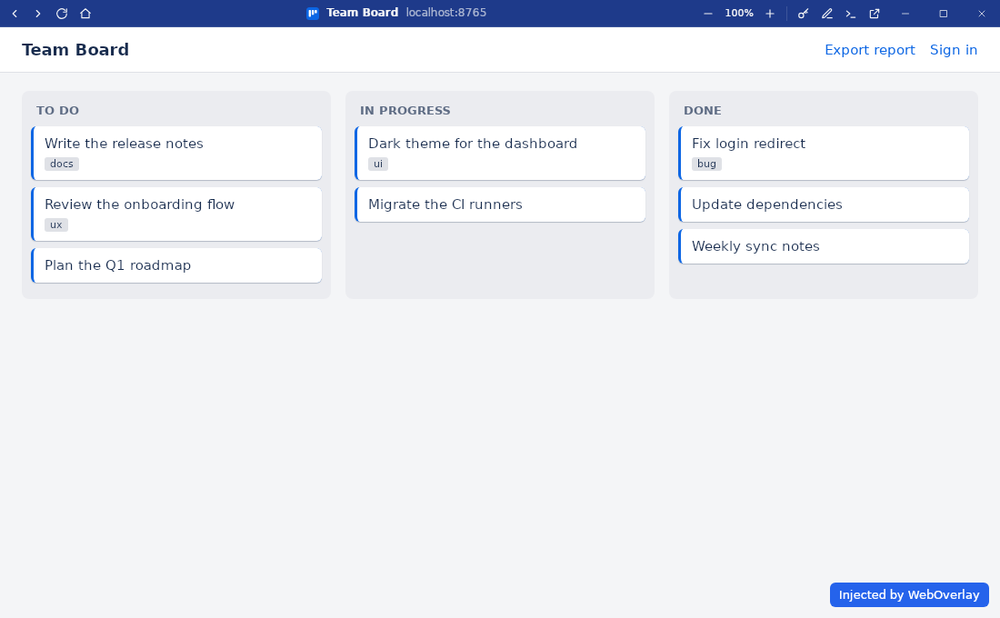

# WebOverlay documentation

| Page | Contents |
| ---- | -------- |
| [Getting started](getting-started.md) | Install, first launch, command line, where configs and profiles live |
| [Configuration](configuration.md) | Every config key, scripts and styles injection, limitations |
| [App window](app-window.md) | Header, shortcuts, icons and taskbar, links, popups, downloads |
| [Launcher](launcher.md) | The app grid shown by `weboverlay` without a config |
| [Editor](editor.md) | Built-in editor for the config, scripts and styles; keyboard shortcuts |
| [Vault](vault.md) | Logins saved in the system keyring and filled into login forms |
| [Building](building.md) | Dev setup, checks, release builds in Docker |
| [Troubleshooting](troubleshooting.md) | GPU-less Linux, AppImage, Windows console, keyring |
