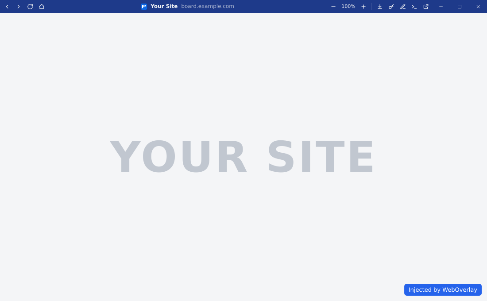
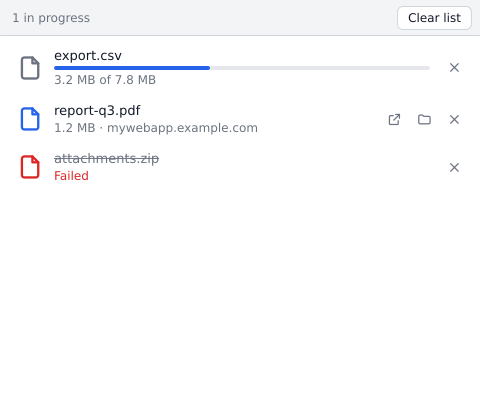

# App window

<picture><source media="(prefers-color-scheme: dark)" srcset="images/app-window-dark.svg"></picture>

Each app opens in its own window with an isolated profile (cookies, storage). The OS title bar is
replaced by the header:

| Item | Action |
| ---- | ------ |
| Back / forward | `Alt+←` / `Alt+→` (always enabled) |
| Reload | `F5` / `Ctrl+R` |
| Home | Back to the config `url` |
| Favicon, title, URL | Current page; drag the header to move the window, double click to maximize |
| Zoom − / % / + | Page zoom; the percentage resets it to the config `zoom` |
| Downloads | Shown after the first download, opens the downloads window |
| Vault (key) | Fill the saved login, or open the [vault](vault.md) |
| Edit (pencil) | Open the [editor](editor.md) |
| Devtools (terminal) | Developer tools (`F12` / `Ctrl+Shift+I` with the header focused) |
| External | Open the page in the system browser |
| Window controls | Minimize, maximize, close |

Hide items with `[app.header] hide`, change its colors with `color` / `text_color`
([Configuration](configuration.md)).

## Icons and taskbar

- The site favicon (or the config `icon`) is used for the header, the window and the taskbar
  (Windows, Linux X11; Wayland uses the `.desktop` file).
- Windows: one taskbar button per app; a pinned app relaunches with its config and its icon.

## Links and popups

- Pages on `allowed_hosts` stay in the app; popups on these hosts open in a plain window
  (`window.opener` kept, so OAuth logins work).
- Other links and popups open in the system browser, except downloads: the URL is fetched once,
  without cookies, and a download stays in the app.
- Remote pages get no access to the app (no Tauri IPC).

## Downloads

A download asks where to save the file with a native "save as" dialog, then shows in the
downloads window: progress, cancel, open, show in folder, remove.

<picture><source media="(prefers-color-scheme: dark)" srcset="images/downloads-dark.svg"></picture>

Extensions listed in `open_downloads` (e.g. `ica`) skip the dialog: saved to the default
downloads folder and opened with their default app.
