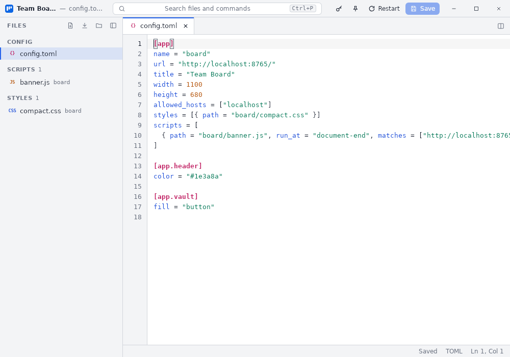
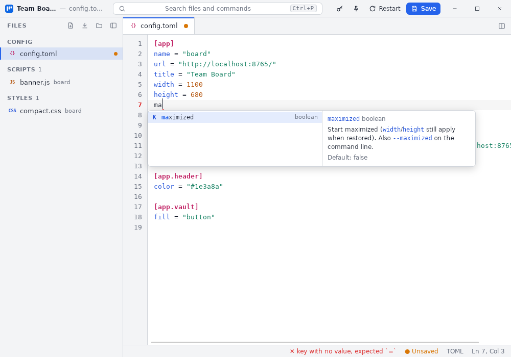

# Editor

The pencil button in the header (or `weboverlay --edit`, which opens only the editor and works with a
missing or invalid config) edits `config.toml` and the script/style files it references.

- TOML/JS/CSS highlighting, line numbers, current line and matching bracket highlight.
- VSCode shortcuts (below), auto-closed brackets and quotes, smart indentation.
- Completion (`Ctrl+Space`, or while typing) with documentation: config keys of the current table
  (`[app]`, `[app.header]`, `scripts`/`styles` items), their values (`run_at`, `hide`, booleans) and
  `[app]` / `[app.header]` headers; JS: keywords, words of the file and DOM members (`document.`,
  `window.`…); CSS: properties, values and `var(--x)`.
- Hover a config key, value or header for its documentation (`Ctrl+K Ctrl+I` at the caret).
- Find / replace (match case, whole word, regex with `$1` groups), quick open of the files, command
  palette, go to line.
- `config.toml` is checked while typing: the error is underlined, its line number turns red and the
  status bar shows it (click to jump there).
- `config.toml` is validated before saving: an invalid config is refused with the error shown.
- Files referenced by the config but missing are marked `missing` and created on save.

## Files

- New scripts and styles from the sidebar (`+`, `Ctrl+N`): the file is created next to the config
  (an existing file is refused) and added to its `scripts` / `styles` (with `run_at` and `matches`),
  comments and layout of `config.toml` kept.
- Import (sidebar button or right click) adds an existing `.js` / `.css`: copied next to the config,
  or referenced in place when it already is under the config directory.
- Right click a file (or a tab) to rename it, remove it from the config (the file is kept), delete
  it, reveal it in the file manager or copy its path. The config itself can be renamed too (same
  directory; the launcher lists follow, a pinned taskbar button still points to the old file).

## Window

- Tabs (drag to reorder, middle click to close) and a second editor group side by side (`Ctrl+\`,
  drag a tab or a sidebar file onto a group); open tabs, split and sidebar width are restored on the
  next opening.
- Own title bar: app icon and name, search (quick open / commands), Vault, Pin, Restart, Save, window
  buttons. Closing the window (or Restart) with unsaved changes asks to save them first.
- Restart reopens the app window with the saved config; the editor stays open.
- Pin keeps the editor above the other windows (also `View: Toggle Always on Top` in the command palette).
- The key button (or `WebOverlay: Manage Logins (Vault)`) opens the [vault](vault.md).

## Keyboard shortcuts

| Keys | Action |
| ---- | ------ |
| `Ctrl+S` · `Ctrl+K S` | Save · save all |
| `Ctrl+N` | New script or style |
| `Ctrl+W` · `Ctrl+K Ctrl+W` | Close tab · close all tabs of the group |
| `Ctrl+\` · `Ctrl+1` / `Ctrl+2` | Split right · focus the first / second group |
| `Ctrl+PageDown` / `Ctrl+PageUp` | Next / previous tab |
| `Ctrl+B` | Toggle the sidebar |
| `Ctrl+/` · `Shift+Alt+A` | Toggle line comment (CSS: block) · block comment |
| `Alt+↑/↓` · `Shift+Alt+↑/↓` | Move · copy line(s) |
| `Ctrl+Shift+K` | Delete line(s) |
| `Ctrl+Enter` · `Ctrl+Shift+Enter` | Insert line below · above |
| `Ctrl+L` · `Ctrl+D` | Select line (repeat to extend) · select word, then its next occurrence |
| `Tab` / `Shift+Tab` · `Ctrl+]` / `Ctrl+[` | Indent / outdent |
| `Home` | First non-blank char, then line start |
| `Ctrl+C` / `Ctrl+X` without selection | Copy / cut the line |
| `Ctrl+Z` · `Ctrl+Y` / `Ctrl+Shift+Z` | Undo · redo |
| `Ctrl+Space` · `Ctrl+K Ctrl+I` | Suggestions · documentation at the caret |
| `Ctrl+F` · `Ctrl+H` | Find · replace (`Enter` / `Shift+Enter`: next / previous, `Ctrl+Alt+Enter`: replace all, `Alt+C` / `Alt+W` / `Alt+R`: case / whole word / regex) |
| `F3` / `Shift+F3` | Next / previous match |
| `Ctrl+P` · `Ctrl+Shift+P` / `F1` · `Ctrl+G` | Quick open file · command palette · go to line (`:line[:column]`) |
| `Ctrl+Tab` / `Ctrl+Shift+Tab` | Next / previous tab (most recently used first) |

Punctuation shortcuts follow the physical US key on other layouts (AZERTY: `Ctrl+$` = `Ctrl+]`, like VSCode).
