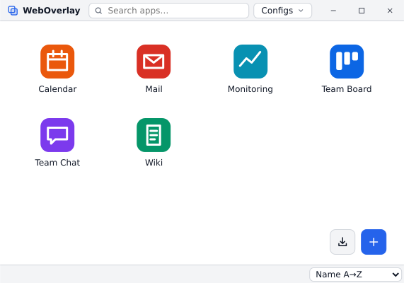

# Launcher

<picture><source media="(prefers-color-scheme: dark)" srcset="images/launcher-dark.svg"></picture>

`weboverlay` without `--config` opens the launcher instead of an app: one grid of app tiles:
the recent apps (the last 10 opened, from the launcher or the command line, stored in
`<local data dir>/weboverlay/recent.json`) and the apps of the other local configs (every `*.toml`
of `<config dir>/weboverlay/` and next to the executable or the `.AppImage` file, configs created or
imported from the launcher). Each app is listed once; recent apps no longer in their config are
greyed out.

Tiles are sorted by name A→Z by default; the sort menu at the right of the status bar switches to
Z→A or to recently opened first (recent apps newest first, then the config apps in config order),
and the choice is remembered. The top bar (search, `Configs`) is the window's title bar: drag it to
move the window, double click to maximize.

One click starts the app in a new WebOverlay process (`--config <path>`); the launcher stays open.
Tiles show the app `icon` from the config, else the app favicon: the last one seen by the app
(cached as `<local data dir>/weboverlay/icons/<id>.png`), else the site's `/favicon.ico`, else a letter.

- **Search**: type anywhere to filter on title, app name and host; `Enter` opens the first match,
  `Esc` clears. Arrow keys move between tiles.
- **App menu** (`⋯` on hover, right click or the menu key): `Open`, `Edit config`, `Remove from recent`.
- **Configs** menu in the header: **Folder config** (`config.toml` next to the executable, when
  present), **User config** (`<config dir>/weboverlay/config.toml`) and the configs created with
  `New config…` or imported, with their path, errors (the button shows how many configs are
  invalid), the app title, `Open` and `Edit` (`Create` when missing: the file is created from the
  same commented example as `New config…`, then opened in the editor).
- **New config…** (`+` button at the bottom right): native "save as" dialog; the file is created from
  a commented example of every key unless it exists, then opened in the [editor](editor.md). These
  configs are stored in `<local data dir>/weboverlay/configs.json`; `Forget` removes one from the
  list (the file is kept).
- **Import…** (import button at the bottom right, left of `+`): native open dialog; adds an existing
  config file to the launcher (same list as `New config…`, the file stays where it is).
