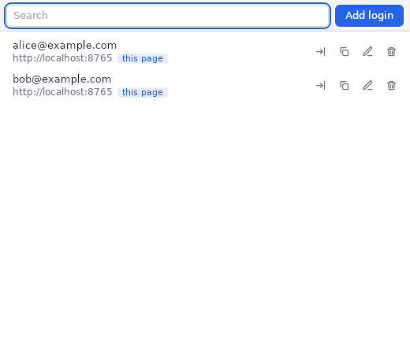
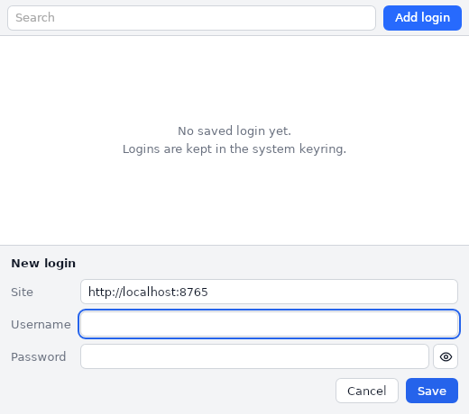

# Vault

The key button of the header fills the login saved for the page origin (`scheme://host[:port]`)
into its login form (username and password, never submitted); with no login or several, it opens
the vault window: add, edit, delete, copy the password, or fill one of the page's logins.
`[app.vault] fill = "auto"` also fills on page load when exactly one login matches.

The key button of the editor title bar (or the `WebOverlay: Manage Logins (Vault)` command) always
opens the vault, also when the app is not running (`--edit`).

- Passwords are stored in the system keyring: Secret Service on Linux (GNOME Keyring, KWallet,
  KeePassXC…, which must be running), Credential Manager on Windows. One entry per login,
  service `dev.blet.weboverlay`.
- Linux without a Secret Service: start with `--password-store=basic` (as in Chromium) to keep
  the passwords in `<local data dir>/weboverlay/vault/<app id>.basic-secrets.json` instead, a
  **plaintext** file readable by your user only (mode 600), with its own login list
  (`<app id>.basic.json`): the two stores don't share logins. The launcher passes the option on
  to the apps and editors it opens.
- The list of logins (origins and usernames, no passwords) is kept in
  `<local data dir>/weboverlay/vault/<app id>.json`, per app and config file.
- Logins are entered by hand: forms submitted in the page are not captured.
- A filled password is readable by every script of that origin, as with any password manager:
  `auto` fills without asking, use it only on sites you trust.
